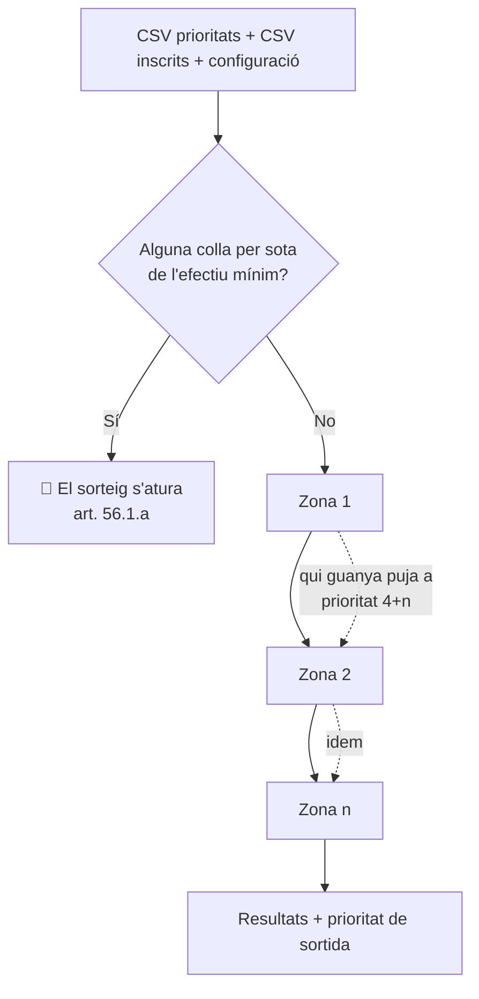
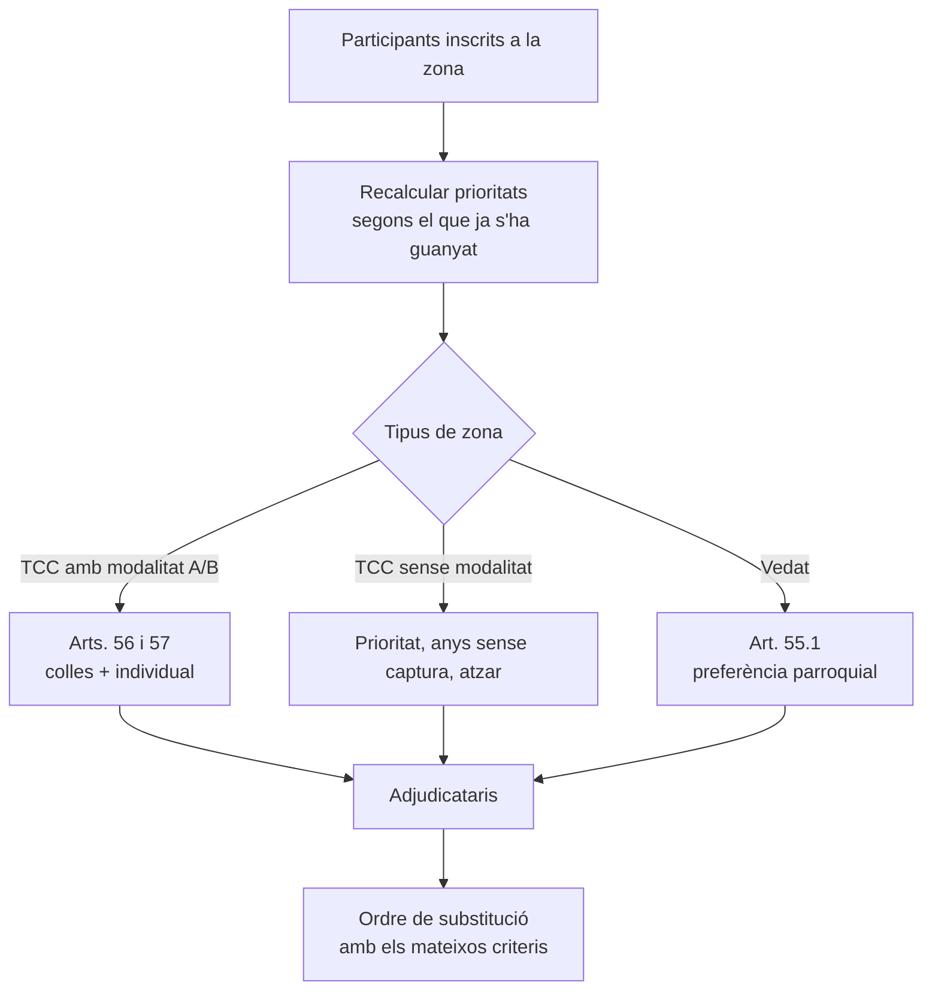
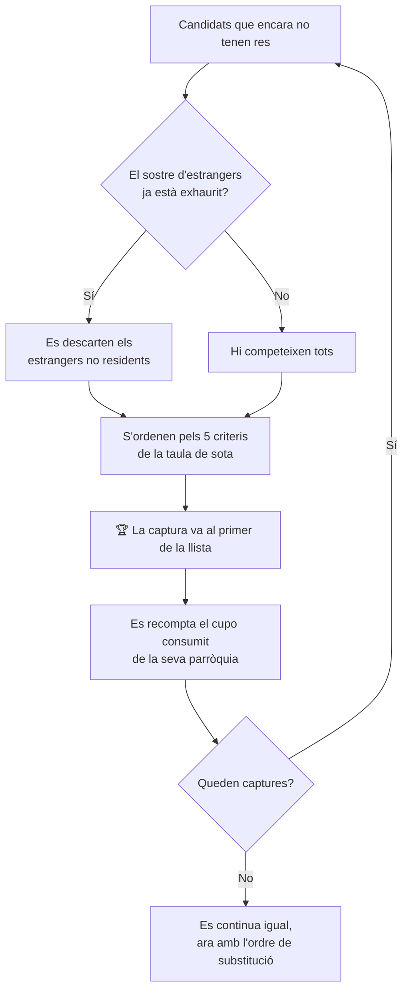
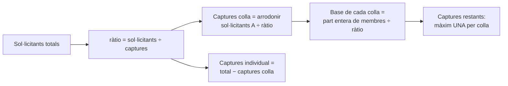
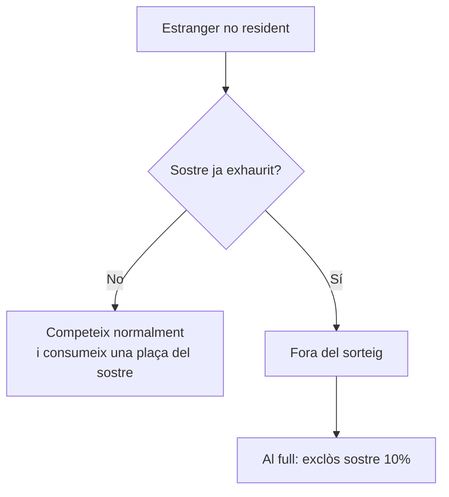

# Manual del sorteig de fauna

**Com decideix l'aplicació cada cas, article per article**

Document de referència de l'aplicació *Sorteig Fauna*, que executa els sortejos de
llicències especials de caça d'espècies sotmeses a pla de caça (isard, cabirol,
mufló i qualsevol espècie nova que s'hi doni d'alta).

Base normativa: **Reglament de caça del 4 de juny del 2025**, articles 52 a 57, i
**Llei 18/2024, del 19 de desembre, de caça**.

> Aquest manual descriu el **comportament real de l'aplicació**. Quan una regla
> admet més d'una lectura del Reglament, hi ha un apartat **«Interpretació
> adoptada»** que diu quina s'ha triat i per què. No n'hi ha cap d'amagada.

---

## Índex

1. [Vocabulari](#1-vocabulari)
2. [Què entra i què surt](#2-què-entra-i-què-surt)
3. [Visió general del procés](#3-visió-general-del-procés)
4. [Les prioritats (art. 54)](#4-les-prioritats-art-54)
5. [Sorteig d'un vedat (art. 55.1)](#5-sorteig-dun-vedat-art-551)
6. [Sorteig en terreny cinegètic comú](#6-sorteig-en-terreny-cinegètic-comú)
7. [Modalitat de colla i individual (arts. 56 i 57)](#7-modalitat-de-colla-i-individual-arts-56-i-57)
8. [Sostre d'estrangers no residents (art. 53.4)](#8-sostre-destrangers-no-residents-art-534)
9. [Ordre de substitució (arts. 55.1.f i 57.4)](#9-ordre-de-substitució-arts-551f-i-574)
10. [Tipus de captura](#10-tipus-de-captura)
11. [Els resultats: columnes i etiquetes](#11-els-resultats-columnes-i-etiquetes)
12. [Prioritat de sortida per a l'any vinent](#12-prioritat-de-sortida-per-a-lany-vinent)
13. [Casuístiques i casos límit](#13-casuístiques-i-casos-límit)
14. [Reproductibilitat](#14-reproductibilitat)
15. [Què no fa l'aplicació](#15-què-no-fa-laplicació)

---

## 1. Vocabulari

| Terme | Significat en aquest manual |
|---|---|
| **Zona** | Cada sorteig independent d'una espècie. L'isard en té quatre: `IS TCC`, `IS VCRS`, `IS VCX`, `IS VCE`. |
| **Vedat** | Zona amb **preferència parroquial** (art. 55.1). |
| **TCC** | Terreny cinegètic comú: zona **sense** preferència parroquial (art. 55.2). |
| **Modalitat A/B** | Mecànica de colles (A) i individual (B) dels arts. 56-57. Avui només l'`IS TCC` de l'isard. |
| **Captura** | Cada llicència especial que es pot adjudicar. |
| **Adjudicatari** | Qui rep una captura. Al full de resultats porta un número: `1`, `2`, `3`… |
| **Substitut** | Qui no rep captura però queda a la llista d'espera ordenada. Porta `s1`, `s2`, `s3`… |
| **Cupo parroquial** | Nombre enter de captures sobre les quals els residents d'una parròquia tenen **preferència**. **No** és un mínim garantit. |
| **Sostre** | Límit superior. N'hi ha dos, i són coses diferents: el **cupo parroquial** (preferència) i el **sostre d'estrangers** (elegibilitat). |
| **Llavor** | Número que fixa l'atzar. Amb la mateixa llavor i les mateixes dades, el sorteig surt idèntic. |

---

## 2. Què entra i què surt

### Entrades

**1. CSV de prioritats** — una fila per caçador del cens:

| Columna | Quan cal | Contingut |
|---|---|---|
| `ID` | sempre | identificador únic |
| `Prioritat` | sempre | 1 a 4 (1 = màxima) |
| `anys_sense_captura` | sempre | enter |
| `Estranger` | sempre | `SI` / `NO` |
| `Parroquia` | si hi ha cap **Vedat** | nom o codi 1-7 |
| `Modalitat`, `Colla_ID` | si hi ha **modalitat A/B** | `A` o `B`; identificador de colla |

**2. CSV d'inscrits** — `ID` i `Codi_Sorteig`, on el codi ha de coincidir **exactament**
amb el nom de la zona configurada.

**3. Configuració de zones** — per a cada zona: tipus, tipus de captura i quantitats,
percentatge d'estrangers, i en els vedats el percentatge reservat als locals i el
repartiment parroquial. S'exporta i s'importa en JSON per reutilitzar-la entre anys.

### Sortida

Una fila per caçador i, per a cada zona, dues columnes: la **posició** (o l'etiqueta
de substitut) i el **tipus de captura**. Més dues columnes finals amb els valors
provisionals de cara a l'any vinent. Detall a l'[apartat 11](#11-els-resultats-columnes-i-etiquetes).

---

## 3. Visió general del procés



Les zones es processen **en l'ordre de la llista** (es reordenen amb ⬆️/⬇️ a la
interfície). L'ordre importa: qui guanya en una zona hi arriba amb la prioritat
empitjorada a la següent (art. 54.2).

Dins de cada zona:



---

## 4. Les prioritats (art. 54)

La prioritat **mana per damunt de tota la resta**, sempre, a totes les zones. Cap
preferència parroquial ni cap altre criteri no fa passar ningú davant d'algú amb
millor prioritat.

| Prioritat | Qui | Article |
|---|---|---|
| **1** | Adjudicatari l'any anterior d'una captura **femella que va ser caçada** | 54.1.a |
| **2** | Es va presentar l'any anterior i **no** va ser adjudicatari (s'incrementa amb els anys consecutius sense adjudicació) | 54.1.b |
| **3** | **No** es va presentar l'any anterior | 54.1.c |
| **4** | La resta de sol·licitants | 54.1.d |
| **4+n** | Qui ja ha obtingut `n` llicències **en els sortejos d'aquest mateix any** | 54.2 |

### La prioritat 4+n, entre zones

És l'única prioritat que calcula l'aplicació sola, i ho fa **entre zones de la
mateixa espècie i del mateix any**:

- Qui guanya una captura passa a **prioritat 5** a totes les zones posteriors.
- Qui en guanya dues passa a **prioritat 6**. I així successivament.

> **Exemple real (isard 2026).** Un caçador amb prioritat 3 que guanya a `IS VCRS`
> arriba a `IS VCE` amb prioritat 5, per darrere de tothom qui encara no ha
> guanyat res, fins i tot dels de prioritat 4.

Aquesta és la raó per la qual **l'ordre de les zones importa** i s'ha de fixar abans
d'executar.

### Desempats

A **igualtat de prioritat** (i, en els vedats, de preferència parroquial):

1. **Més anys sense captura** passa davant.
2. Si encara hi ha empat, **atzar**.

---

## 5. Sorteig d'un vedat (art. 55.1)

És la part amb més casuística. Es fa en aquest ordre:

### 5.1 Es sorteja l'ordre de les parròquies (art. 55.1.b)

Primer de tot, abans de repartir res, es **sorteja l'ordre** de les parròquies del
vedat. Aquest ordre queda registrat i es publica amb els resultats.

Fa dues feines:

- Desfà els **empats del repartiment del cupo** (apartat següent).
- Desfà els **empats entre residents de parròquies diferents** amb la mateixa prioritat.

### 5.2 Es reparteix el cupo per superfície (art. 55.1.a.i)

El percentatge reservat als locals (per defecte el **50%**, «com a mínim» segons
l'article) es converteix en un **nombre enter de captures per parròquia**:

```
1. Total reservat = arrodoniment del 50% del total de captures, amb els mitjos amunt.
   Exemple: 50% de 9 captures = 4,5 → 5.

2. Es reparteix aquest total entre les parròquies segons la seva superfície,
   pel mètode del residu més gran.

3. Els empats de residu els desfà l'ORDRE PARROQUIAL SORTEJAT.
```

> **Exemple 1 — `IS VCE`, 30 captures.** Reservat: 50% de 30 = 15.
> Superfícies: La Massana 23,4% · Andorra la Vella 52,2% · Sant Julià 24,1% · Escaldes 0,3%.
>
> | Parròquia | Exacte | Part entera | Residu | Cupo final |
> |---|---|---|---|---|
> | Andorra la Vella | 7,83 | 7 | 0,83 → **+1** | **8** |
> | Sant Julià de Lòria | 3,615 | 3 | 0,615 → **+1** | **4** |
> | La Massana | 3,51 | 3 | 0,51 | **3** |
> | Escaldes-Engordany | 0,045 | 0 | 0,045 | **0** |
> | | | 13 | falten 2 | **15** |

> **Exemple 2 — `IS VCRS`, 10 captures, empat.** Reservat: 50% de 10 = 5.
> Canillo 50% i Ordino 50% → 2,5 cadascuna. Part entera 2 + 2 = 4, en falta 1, i el
> residu és **idèntic**. El desempat el fa el sorteig de l'apartat 5.1: **la parròquia
> que ha sortit primera es queda el 3**, l'altra el 2.

⚠️ Escaldes-Engordany surt amb cupo **0** a `IS VCE`. No és cap error: amb un 0,3%
de la superfície del vedat, li correspon zero. Els seus residents hi poden guanyar
igualment, però **només per prioritat**, sense preferència.

### 5.3 S'adjudiquen les captures, una a una

Les captures **no** es reparteixen per blocs. Es van adjudicant d'una en una, i
**després de cada adjudicació es torna a avaluar tothom**:



Els cinc criteris, **estrictament en aquest ordre**. Només es passa al següent si
els anteriors donen empat:

| | Criteri | Article | Comentari |
|---|---|---|---|
| **1r** | Millor **prioritat** | 54 | Mana sempre. Cap dels altres criteris no la pot capgirar. |
| **2n** | Ser **resident d'una parròquia que encara no ha arribat al seu cupo** | 55.1.a | Aquí és on actua la preferència parroquial. |
| **3r** | **Ordre parroquial sortejat** | 55.1.b | Només desempata entre residents que tinguin preferència. |
| **4t** | **Més anys sense captura** | — | Desempat de gestió. |
| **5è** | **Atzar** | — | Reproduïble amb la llavor. |

Com que el consum del cupo es recompta a cada volta, **la preferència s'apaga sola**
en el moment exacte que una parròquia arriba al seu sostre.

### 5.4 El cupo és un SOSTRE, no un terra

Aquesta és la confusió més freqüent, i val la pena insistir-hi:

| | |
|---|---|
| ✅ **El que és** | Un **límit a la preferència**. Mentre la parròquia estigui per sota del seu cupo, els seus residents passen davant **a igualtat de prioritat**. |
| ❌ **El que NO és** | Una reserva garantida de captures. |

Conseqüències, totes dues normals i esperades:

- **Es pot quedar per sota.** Si els no residents tenen millor prioritat, s'enduen
  les captures igualment. *A la prova de l'isard del 2026, a `IS VCRS` nou de les
  deu captures van a no residents: tenien prioritat 2 i 3, i els residents de
  Canillo i Ordino, prioritat 4. El cupo reservat era de 5 captures i se'n va
  cobrir una.*
- **Es pot superar.** Un cop exhaurit el cupo, els residents perden la preferència
  però **segueixen competint per prioritat** i poden guanyar-ne més. *A la mateixa
  prova, a `IS VCE` La Massana tenia cupo 3 i en va obtenir 8.*

### 5.5 Ordre de la taula de cupos

La taula que es publica amb els resultats surt **en l'ordre parroquial sortejat**,
amb la columna `Ordre` (1r, 2r, 3r…), perquè coincideixi amb el text que la precedeix.

---

## 6. Sorteig en terreny cinegètic comú

En una zona **TCC sense modalitat A/B** no hi ha cap preferència parroquial
(art. 55.2.a). Un únic sorteig amb la cascada reduïda:

1. Millor prioritat.
2. Més anys sense captura.
3. Atzar.

I el sostre d'estrangers per damunt, com a tot arreu.

---

## 7. Modalitat de colla i individual (arts. 56 i 57)

S'activa amb la casella **Modalitat A/B** de la zona. Avui només la fa servir
l'`IS TCC` de l'isard.

### 7.1 Comprovació prèvia: efectiu mínim (art. 56.1.a)

Una colla ha de tenir **com a mínim 6 integrants** (configurable). Si alguna colla
inscrita no hi arriba, **el sorteig no s'executa**: surt un error amb la llista de
colles curtes i cal corregir el CSV d'inscrits. És una aturada deliberada, no una
correcció silenciosa.

### 7.2 Ràtio de distribució (art. 56.2)

```
ràtio = nombre total de sol·licitants ÷ nombre de captures del pla
```

Es fa servir **exacta**, sense arrodonir.

### 7.3 Repartiment entre modalitats (art. 56.3)



### 7.4 Dins la modalitat de colla (arts. 56.4 i 57.1)

1. **Base de cada colla** = part entera de (membres de la colla ÷ ràtio). Es
   reparteix entre els seus integrants per prioritat.
2. **Captures restants** (les que no ha absorbit cap base) se sortegen entre els
   **no adjudicataris** de la modalitat de colla, per prioritat, amb un **màxim
   d'una addicional per colla**.

### 7.5 Modalitat individual (arts. 56.5 i 57.2)

Les captures que queden es reparteixen entre els sol·licitants de modalitat B per
prioritat.

### 7.6 Interpretació adoptada: el romanent decimal

> **El Reglament** (arts. 56.4.b, 56.5.b i 56.6) diu de prendre la **part entera**
> de cada modalitat i deixar la part decimal com a **romanent**, que després se
> sorteja entre els no adjudicataris de totes dues modalitats.
>
> **L'aplicació** arrodoneix les captures de cada modalitat **al valor enter més
> proper** — i, en un empat exacte a 0,5, **sorteja** cap a quin costat cau. Així
> **no queda cap romanent** i totes les captures del pla queden repartides dins de
> la seva modalitat.
>
> **Per què.** El resultat final és el mateix nombre total de captures adjudicades,
> i s'evita una tercera volta amb un romanent que, amb les xifres reals, sempre
> resulta ser d'una o dues captures. Criteri acordat amb el Govern al juliol del
> 2026. Si es prefereix la lectura literal, és un canvi acotat.

---

## 8. Sostre d'estrangers no residents (art. 53.4)

> *«El 10%, com a màxim, de les llicències especials de caça de cada pla de caça es
> poden adjudicar a persones sol·licitants estrangeres no residents.»*

### 8.1 Com es calcula

```
sostre = part entera de (percentatge configurat × captures de la zona)
```

Es calcula **per zona**, sobre les captures ofertes.

> **Atenció al truncament en zones petites.** Amb el 10%: 30 captures → sostre 3;
> 10 captures → sostre 1; 6 captures → sostre **0**. En una zona de menys de 10
> captures, el sostre del 10% deixa els estrangers fora del tot.

### 8.2 Què compta contra el sostre

**Les captures adjudicades i les substitucions, per igual.** Un cop exhaurit, els
estrangers no residents **queden fora del sorteig**: ni reben captura ni reben ordre
de substitució.



### 8.3 Interpretació adoptada: per què no queden com a substituts

> Un substitut que entra **passa a ser adjudicatari**. Si el sostre ja està ple i
> el següent de la llista és estranger, adjudicar-li la plaça portaria el pla per
> sobre del 10%.
>
> **El criteri adoptat** és que la llicència es considera **adjudicada tant si qui
> la té hi accedeix com si desisteix**: amb el sostre consumit, la quota del pla
> està gastada i complerta, i cap estranger no hi pot entrar per substitució.
>
> **Conseqüència, dita expressament:** si un estranger adjudicatari desisteix, la
> seva plaça la cobreix el següent de la llista general, que serà un resident. No
> se substitueix un estranger per un altre estranger.
>
> Criteri acordat amb el Govern el 12 d'agost del 2026.

> **Cas real que ho va motivar (isard 2026, `IS VCE`).** 30 captures, sostre 3, i
> les 3 se les van endur estrangers en l'atorgament de captures. Amb el criteri
> anterior, **els quatre primers substituts de la llista eren estrangers**: la baixa
> de qualsevol dels 27 adjudicataris residents hauria donat una quarta llicència a
> un estranger, un 13,3%.

### 8.4 Marcatge al full

Els descartats pel sostre porten l'etiqueta **`exclòs (sostre 10%)`**, no una cel·la
buida. La distinció importa: una cel·la buida vol dir **«no inscrit en aquesta
zona»**. A efectes de la prioritat de l'any vinent **compten com a presentats sense
adjudicació**.

---

## 9. Ordre de substitució (arts. 55.1.f i 57.4)

Un cop adjudicades totes les captures, la resta de participants reben un ordre de
substitució: `s1`, `s2`, `s3`…

**No és una llista a part: és la continuació del mateix sorteig, amb els mateixos
criteris.**


Això vol dir, en un vedat:

- La **prioritat** segueix manant.
- La **preferència parroquial segueix vigent** mentre la parròquia no hagi exhaurit
  el seu cupo, perquè un substitut que entra ocupa una captura del vedat.
- El **sostre d'estrangers** segueix comptant (apartat 8).

> **Exemple (`IS VCRS`, prova del 2026).** Nou de les deu captures van a no
> residents per prioritat, i el cupo parroquial queda gairebé intacte: en aquella
> execució, Canillo a 1 de 3 i Ordino a 0 de 2. Els primers substituts són, per
> tant, **s1 i s2 de Canillo i s3 i s4 d'Ordino**, que completen el sostre. A
> partir d'`s5` ja mana només la prioritat.
>
> *Els noms i els números concrets depenen de l'ordre parroquial sortejat; el que
> és sempre igual és el mecanisme.*

---

## 10. Tipus de captura

Una zona pot oferir diversos tipus (`Adult`, `Juvenil`, `Trofeu`, `Selectiu`,
`Femella`, `Mascle`, `Indeterminat`) amb una quantitat cadascun.

- **L'ordre d'adjudicació** el fixa sempre la prioritat. Això no es toca mai.
- **Quin tipus toca a cada adjudicatari** depèn de la casella *Ordre aleatori*:
  - **Desmarcada**: els tipus es reparteixen en l'ordre configurat. El primer
    adjudicatari s'endú el primer tipus de la llista.
  - **Marcada**: la bossa de tipus es barreja abans de repartir-la.
- **Els substituts no porten cap tipus.** La columna `Tipus_<zona>` queda buida per
  a ells: el tipus s'assigna en el moment de l'adjudicació efectiva.

⚠️ *Ordre aleatori* **no** aleatoritza qui guanya. Només quin tipus de captura rep
cadascú.

---

## 11. Els resultats: columnes i etiquetes

Per a cada zona hi ha dues columnes: `<zona>` i `Tipus_<zona>`.

| Valor a `<zona>` | Vol dir |
|---|---|
| `1`, `2`, `3`… | **Adjudicatari**, i la posició en què li va tocar |
| `s1`, `s2`, `s3`… | **Substitut**, i el seu ordre a la llista d'espera |
| `exclòs (sostre 10%)` | Estranger no resident **descartat pel sostre** de l'art. 53.4 |
| *(buit)* | **No inscrit** en aquesta zona |

I al final del full:

| Columna | Contingut |
|---|---|
| `Nou_Anys_sense_captura` | `0` si ha obtingut alguna captura; si no, l'anterior + 1 |
| `Nova_prioritat` | Estimació de sortida per a l'any vinent (apartat 12) |

A més, amb els resultats es publica, per a cada vedat, **l'ordre parroquial sortejat
i la taula de cupos**, i un **resum per zona** amb les assignacions previstes, les
sol·licituds, les assignacions finals, el percentatge d'estrangers i el recompte
d'adjudicataris per parròquia.

---

## 12. Prioritat de sortida per a l'any vinent

L'aplicació proposa `Nova_prioritat` així:

| Situació | `Nova_prioritat` |
|---|---|
| Ha obtingut captura en alguna zona | **4** |
| S'ha presentat i no n'ha obtingut cap | **2** |

⚠️ **Són valors provisionals.** Les prioritats **1** (femella efectivament caçada,
art. 54.1.a) i **3** (no presentats, art. 54.1.c) **les han de fixar els tècnics del
Govern**, perquè depenen d'informació que l'aplicació no té: si la captura es va
arribar a fer i quin animal era, i el cens complet de qui no s'ha presentat.

---

## 13. Casuístiques i casos límit

| Cas | Què fa l'aplicació |
|---|---|
| **Una colla per sota de l'efectiu mínim** | 🚫 Atura el sorteig i llista les colles curtes (art. 56.1.a) |
| **`ID` duplicat al CSV d'inscrits d'una zona** | 🚫 Atura el sorteig amb error |
| **Zona amb 0 captures configurades** | Se la salta. La columna surt buida per a tothom |
| **Zona sense cap inscrit** | Se la salta igualment |
| **Menys sol·licitants que captures** | Adjudica les que pot; **la resta queden sense adjudicar** (vegeu l'apartat 15) |
| **Parròquia buida, no reconeguda, o de fora del vedat** | El caçador compta com a **no resident**: sense preferència, però competeix per prioritat |
| **Parròquia amb cupo 0** (p. ex. Escaldes al `VCE`) | Els seus residents no tenen mai preferència; competeixen només per prioritat |
| **Sostre d'estrangers a 0** (percentatge 0, o zona petita) | Cap estranger no pot rebre captura ni ordre de substitució; queden marcats `exclòs (sostre 10%)` |
| **Només queden estrangers i el sostre és ple** | El sorteig s'atura de manera ordenada; les captures sobrants queden sense adjudicar |
| **Empat exacte al repartiment del cupo** | El desfà l'ordre parroquial sortejat (art. 55.1.b) |
| **Un vedat d'una sola parròquia** | No hi ha res a sortejar: l'ordre és aquella parròquia i s'endú tot el cupo |
| **Un vedat sense repartiment parroquial configurat** | Es comporta com una zona sense preferència parroquial |
| **Guanyar en dues zones el mateix any** | La prioritat passa a 5, i després a 6, a les zones posteriors (art. 54.2) |
| **Caçador amb `Modalitat` però no inscrit al CSV** | En una zona amb modalitat A/B, se l'hi admet igualment |

---

## 14. Reproductibilitat

Si s'introdueix una **llavor**, el sorteig és **exactament reproduïble**: mateixes
dades + mateixa configuració + mateixa llavor = mateix resultat, fins a l'últim
substitut. Sense llavor, cada execució dóna un resultat diferent.

**Recomanació:** fixar sempre una llavor i **deixar-la escrita a l'acta**. Permet
tornar a generar el sorteig sencer si més endavant cal comprovar-lo o reconstruir-lo.

L'aplicació es valida amb **19 proves automàtiques** que comproven, contra fitxers
reals, la jerarquia de prioritats, el càlcul dels cupos, la preferència parroquial
com a sostre, l'ordre de substitució, els dos sostres i la reproductibilitat.

---

## 15. Què no fa l'aplicació

Perquè quedi clar el límit del que hi ha automatitzat:

- **No aplica l'art. 55.3** (més captures que sol·licitants: adjudicar-ne una segona
  als mateixos, per ordre i amb la seva acceptació voluntària). Si sobren captures,
  queden sense adjudicar i s'han de resoldre a mà.
- **No fixa les prioritats 1 i 3** de l'any vinent (apartat 12).
- **No gestiona les baixes ni les substitucions efectives.** Produeix l'ordre; qui
  entra i quan ho decideix el Govern.
- **No comprova el cens.** Es fia del que digui el CSV de prioritats: parròquia,
  condició d'estranger i prioritat d'entrada.
- **No emet les llicències** ni cap document administratiu.

---

*Aplicació desenvolupada per a la Direcció de Medi Ambient. Manual actualitzat el
12 d'agost del 2026, amb el comportament vigent després de les correccions
d'agost sobre l'ordre parroquial, l'ordre de substitució i el sostre d'estrangers.*
